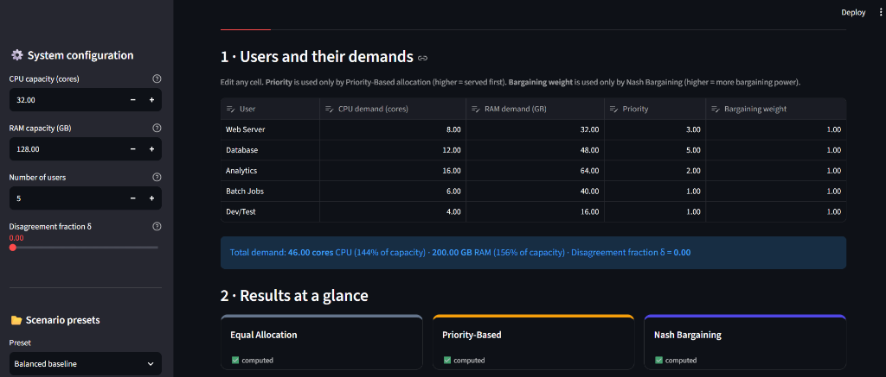
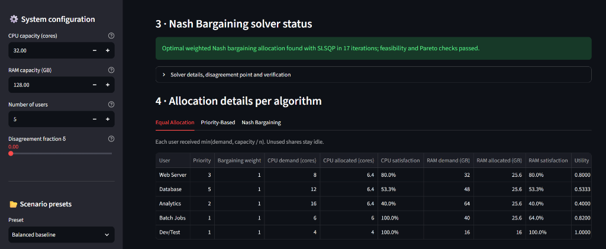
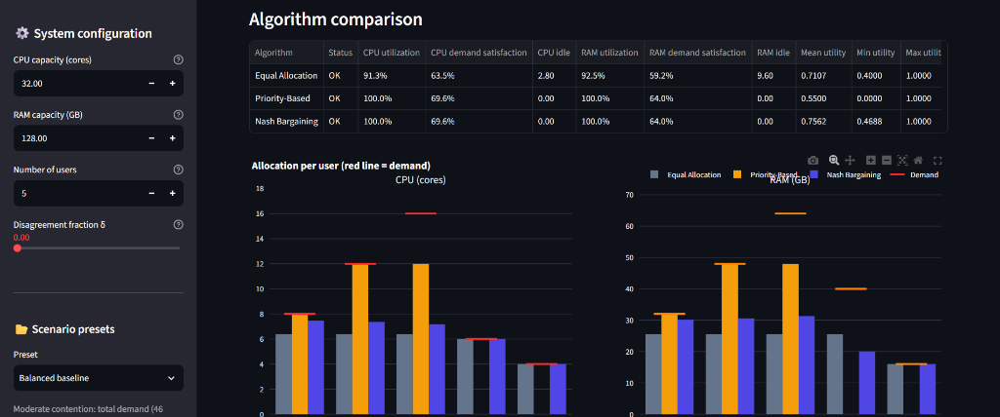
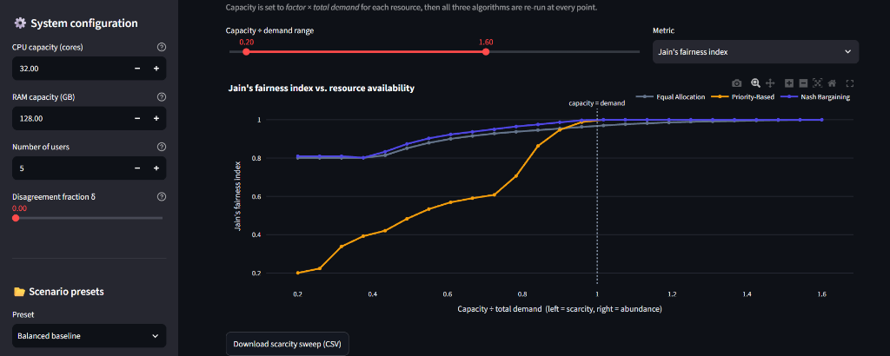

<p align="center">
  
  
  
  
  
</p>

# ☁️ Game-Theoretic Bargaining for Fair and Efficient Allocation of Computational Resources in Cloud Computing

An interactive **Streamlit dashboard** that models the allocation of **CPU cores** and **RAM** among competing cloud users using cooperative game theory. It compares three allocation strategies — **Equal Allocation**, **Priority-Based Allocation**, and the **Weighted Nash Bargaining Solution (NBS)** — with real constrained optimization, full input validation, and rigorous correctness checks.

---

## 🎯 Motivation

Cloud computing environments face a fundamental challenge: **how to fairly and efficiently distribute limited resources among multiple competing tenants**. Traditional approaches often sacrifice fairness for efficiency or vice versa. This project applies **John Nash's cooperative bargaining theory** to find allocations that are provably:

- **Pareto efficient** — no capacity sits idle while someone still needs it
- **Fair** — no user is starved without a principled reason
- **Axiomatically justified** — backed by Nash's four bargaining axioms

---

## ✨ Features

### 📊 Interactive Dashboard
- Configure **CPU/RAM capacity**, number of users (up to 12), individual demands, priorities, bargaining weights, and the disagreement fraction δ
- Live **input validation** with clear error messages and warnings
- Real-time computation of all three allocation algorithms

### 📈 Algorithm Comparison
- Side-by-side comparison with **6 interactive Plotly charts**:
  - Allocation per user (with demand markers)
  - User utility (demand satisfaction)
  - Jain's Fairness Index
  - Weighted log Nash product
  - Resource utilization
  - Aggregate demand satisfaction
- Summary metrics table with Pareto efficiency check

### 🧪 Experiment Lab
- **6 preset scenarios**: Balanced baseline, Resource scarcity, Abundant resources, Unequal priorities, Unequal demands, Different bargaining weights
- **3 parameter sweeps** (re-runs real algorithms at every point):
  - **Scarcity → Abundance**: capacity scaled from 0.1× to 2.5× total demand
  - **Bargaining Power**: vary one user's weight and watch their share grow
  - **Disagreement Point**: vary δ to see how fallback guarantees affect the outcome

### 📥 Export
- Download CSV files for per-user allocations, algorithm comparison, scenario inputs, and sweep results
- UTF-8 with BOM for seamless Excel compatibility on Windows

---

## 📸 Screenshots & Visual Overview

<p align="center">
  <b>1. System Configuration, Demands & Results at a Glance</b><br>
  
</p>

<p align="center">
  <b>2. Nash Bargaining Optimization Status & Per-Algorithm Allocation</b><br>
  
</p>

<p align="center">
  <b>3. Algorithm Comparison Table & Allocation per User (CPU & RAM)</b><br>
  
</p>

<p align="center">
  <b>4. Experiment Lab: Scarcity → Abundance Sweep (Jain's Fairness Index)</b><br>
  
</p>

---

## 📐 Mathematical Model

### Notation

| Symbol | Meaning |
|--------|---------|
| $n$ | Number of users |
| $C_r$ | Capacity of resource $r$ (CPU or RAM) |
| $d_{ir}$ | Demand of user $i$ for resource $r$ |
| $x_{ir}$ | Amount allocated to user $i$ (decision variable) |
| $p_i$ | Priority (Priority-Based only) |
| $w_i$ | Bargaining weight (Nash Bargaining only) |
| $\delta$ | Disagreement fraction (fallback guarantee) |

### Constraints

Every valid allocation must satisfy:

$$\sum_{i=1}^{n} x_{ir} \le C_r \quad \text{(capacity)}, \qquad 0 \le x_{ir} \le d_{ir} \quad \text{(no over-allocation)}$$

### Utility Function

Each user's satisfaction is their **average demand fulfillment** across requested resources:

$$u_i(x) = \frac{1}{|R_i|} \sum_{r \in R_i} \frac{x_{ir}}{d_{ir}}, \qquad R_i = \{ r : d_{ir} > 0 \}$$

- $u_i = 0$: user got nothing
- $u_i = 1$: user got everything they asked for

### Disagreement Point

The fallback utility if negotiations fail:

$$b_{ir} = \min\!\left(d_{ir},\ \frac{\delta \cdot C_r}{n_{\text{active}}}\right), \qquad D_i = u_i(b)$$

### The Three Algorithms

| # | Algorithm | Formula / Method | Pros | Cons |
|---|-----------|-----------------|------|------|
| 1 | **Equal Allocation** | $x_{ir} = \min(d_{ir}, C_r / n)$ | Simple, symmetric | Unused shares stay idle (not Pareto efficient) |
| 2 | **Priority-Based** | Serve users in descending priority; ties use water-filling | Uses all capacity | Low-priority users can be starved |
| 3 | **Weighted Nash Bargaining** | Solve the optimization below | Pareto efficient **and** fair | Requires numerical optimization |

### Nash Bargaining Optimization

$$\max_{x} \sum_{i} w_i \log\big(u_i(x) - D_i\big)$$

$$\text{s.t.}\quad \sum_i x_{ir} \le C_r,\quad 0 \le x_{ir} \le d_{ir},\quad u_i(x) > D_i$$

The objective is **concave** and constraints are **linear** → the problem is **convex**, so the local optimum found by SciPy's SLSQP solver is the **global optimum**. If SLSQP fails, `trust-constr` is used as a fallback. Results are accepted **only** after passing feasibility, individual-rationality, and Pareto checks.

### Performance Metrics

$$\text{Utilization}_r = \frac{\sum_i x_{ir}}{C_r} \qquad \text{Demand satisfaction}_r = \frac{\sum_i x_{ir}}{\sum_i d_{ir}}$$

$$J(u_1, \dots, u_k) = \frac{\left(\sum_i u_i\right)^2}{k \sum_i u_i^2}, \qquad \frac{1}{k} \le J \le 1$$

**Jain's Fairness Index** = 1 when all users are equally satisfied; = 1/k when one user gets everything.

---

## ⚠️ NBS ≠ Nash Equilibrium

| | **Nash Bargaining Solution** | **Nash Equilibrium** |
|---|---|---|
| Game type | Cooperative (players negotiate a binding agreement) | Non-cooperative (each player acts alone) |
| Defined by | Axioms / maximizing the Nash product | No player gains by changing only its own strategy |
| Output | One agreed allocation | A strategy profile (may be several) |
| Efficiency | Always Pareto efficient | Can be inefficient (e.g., Prisoner's Dilemma) |
| Role of $D$ | Central: gains are measured from the disagreement point | No disagreement point |
| **In this project** | ✅ What we compute | ❌ Not computed — mentioned for contrast |

---

## 🏗️ Project Structure

```
cloud-bargaining/
├── app.py                       # Streamlit UI (no business logic)
├── src/
│   ├── __init__.py
│   ├── models.py                # Scenario & AllocationResult dataclasses
│   ├── validation.py            # Input checks (errors vs. warnings)
│   ├── game_theory.py           # Utilities, disagreement point, Nash optimization
│   ├── algorithms.py            # Equal, Priority-Based, water-filling, run_all
│   ├── metrics.py               # Utilization, satisfaction, Jain's index, comparison
│   ├── experiments.py           # 6 presets and 3 parameter sweeps
│   ├── charts.py                # All Plotly figures
│   └── export.py                # CSV export helpers
├── tests/
│   ├── conftest.py              # Shared fixtures
│   ├── test_algorithms.py       # Equal & Priority-Based tests
│   ├── test_game_theory.py      # NBS solver, axioms, edge cases
│   ├── test_metrics_and_experiments.py
│   ├── test_charts.py           # Chart rendering tests
│   ├── test_validation.py       # Input validation tests
│   └── test_app.py              # Streamlit headless UI tests (AppTest)
├── requirements.txt
├── pytest.ini
└── README.md
```

### Architecture

```
┌─────────────────────────────────────────────────────────────────┐
│                         app.py (UI)                             │
│       Dashboard │ Comparison │ Experiment Lab │ Export          │
└──────┬──────────┬────────────┬──────────────┬───────────────────┘
       │          │            │              │
       ▼          ▼            ▼              ▼
  ┌─────────┐ ┌────────┐ ┌────────────┐ ┌────────┐
  │algorithms│ │ charts │ │experiments │ │ export │
  │  .py     │ │  .py   │ │   .py      │ │  .py   │
  └────┬─────┘ └───┬────┘ └─────┬──────┘ └───┬────┘
       │           │            │             │
       ▼           ▼            ▼             ▼
  ┌──────────────────────────────────────────────┐
  │             game_theory.py                   │
  │  utility_coefficients · disagreement_point   │
  │  nash_bargaining_solution · verification     │
  └──────────────────┬───────────────────────────┘
                     │
          ┌──────────┼──────────┐
          ▼          ▼          ▼
     models.py  validation.py  metrics.py
```

---

## 🚀 Getting Started

### Prerequisites

- **Python 3.10** or newer
- **pip** (comes with Python)

### Installation & Run (Windows PowerShell)

```powershell
# Clone the repository
git clone https://github.com/Aayush2477/cloud-bargaining.git
cd cloud-bargaining

# Create and activate virtual environment
python -m venv .venv
.\.venv\Scripts\Activate.ps1
python -m pip install --upgrade pip

# Install dependencies
pip install -r requirements.txt

# Run the test suite (74 tests)
python -m pytest

# Launch the dashboard
streamlit run app.py
```

> **Note:** If activation is blocked by execution policy, run this once:
> ```powershell
> Set-ExecutionPolicy -Scope CurrentUser -ExecutionPolicy RemoteSigned
> ```

### Installation & Run (macOS / Linux)

```bash
git clone https://github.com/Aayush2477/cloud-bargaining.git
cd cloud-bargaining

python3 -m venv .venv && source .venv/bin/activate
pip install -r requirements.txt
python -m pytest
streamlit run app.py
```

The app opens at **http://localhost:8501**.

---

## 📦 Dependencies

| Package | Version | Purpose |
|---------|---------|---------|
| [Streamlit](https://streamlit.io/) | ≥ 1.50 | Interactive web dashboard |
| [NumPy](https://numpy.org/) | ≥ 1.26 | Numerical arrays and linear algebra |
| [SciPy](https://scipy.org/) | ≥ 1.11 | Constrained optimization (SLSQP, trust-constr) |
| [Pandas](https://pandas.pydata.org/) | ≥ 2.1 | Data manipulation and CSV export |
| [Plotly](https://plotly.com/python/) | ≥ 5.20 | Interactive charts and visualizations |
| [pytest](https://pytest.org/) | ≥ 8.0 | Test framework |

---

## 🧪 Test Suite

The project includes **74 comprehensive tests** covering:

| Category | What is tested |
|----------|---------------|
| **Closed-form answers** | Single-resource NBS equals weighted water-filling (with and without disagreement) |
| **Nash axioms** | Symmetry, unit (scale) invariance, Pareto efficiency, individual rationality |
| **Optimality** | NBS beats 3,000 random feasible allocations and every other algorithm on the Nash product |
| **Monotonicity** | A higher bargaining weight never lowers that user's utility |
| **Edge cases** | Zero-demand users, all-zero demand, users satisfied by the fallback share, single user |
| **Failure safety** | Crashed solver, diverged solver, and false success claims are all reported as FAILED |
| **UI (headless)** | `app.py` run via Streamlit AppTest — presets, resizing, validation, reset, Experiment Lab |

Run the full suite:

```bash
python -m pytest          # quiet mode (default via pytest.ini)
python -m pytest -v       # verbose output
python -m pytest --tb=short  # short tracebacks
```

---

## 📊 Preset Scenarios

| Scenario | CPU | RAM | δ | Description |
|----------|-----|-----|---|-------------|
| **Balanced baseline** | 32 cores | 128 GB | 0.0 | Moderate contention; total demand exceeds capacity |
| **Resource scarcity** | 16 cores | 64 GB | 0.0 | Only ~⅓ of demand available; shows how each algorithm handles pain |
| **Abundant resources** | 64 cores | 256 GB | 0.0 | Capacity exceeds every demand; all should satisfy everyone |
| **Unequal priorities** | 24 cores | 96 GB | 0.0 | One critical service has priority 10; others have 1–2 |
| **Unequal demands** | 32 cores | 128 GB | 0.0 | One huge user (40 cores, 160 GB) alongside small ones |
| **Different weights** | 32 cores | 128 GB | 0.1 | Varying bargaining power (4, 2, 1, 1, 1) |

---

## 🔑 Key Results to Observe

- **Under scarcity**: Priority-Based gives some users utility 0 (Jain's index drops sharply). NBS spreads the shortage so everyone gets something while still using 100% of capacity.
- **Under abundance**: NBS and Priority-Based both satisfy everyone. Equal Allocation may still leave capacity idle.
- **Unequal demands**: Equal Allocation wastes small users' unused shares; NBS redistributes them to large users.
- **Bargaining weights**: Increasing $w_i$ never lowers user $i$'s utility (monotonicity, verified by Experiment B).
- **Disagreement point**: Raising δ protects users with small fallback options (Experiment C).

---

## 🎓 Academic Context

This project implements concepts from:

- **Nash, J. F. (1950).** *The Bargaining Problem.* Econometrica, 18(2), 155–162.
- **Jain, R., Chiu, D., & Hawe, W. (1984).** *A Quantitative Measure of Fairness and Discrimination for Resource Allocation in Shared Computer Systems.* DEC Technical Report.
- Cooperative game theory and mechanism design applied to cloud resource management.

---

## 👥 Authors

- **Aayush Garg**
  - 📧 aayushgarg247@gmail.com
  - 🐙 [GitHub](https://github.com/Aayush2477)

- **Sanskar Jaiswal**

---

## 📄 License

This project is licensed under the **MIT License** — see the [LICENSE](LICENSE) file for details.
